<p align="center">
  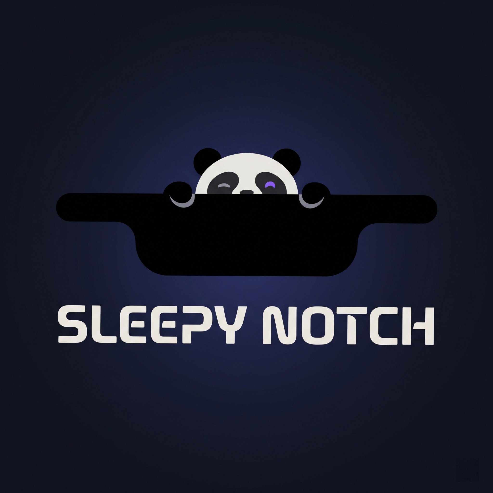
</p>

<h1 align="center">Sleepy Notch</h1>

<p align="center">
  <b>Your MacBook's notch, awake.</b><br>
  Music, files and what your Mac is doing, right under the camera.
</p>

<p align="center">
  
  
  <a href="https://github.com/anand-exe7/Sleepy-Notch/releases/latest"></a>
  
  <a href="LICENSE"></a>
</p>

<p align="center">
  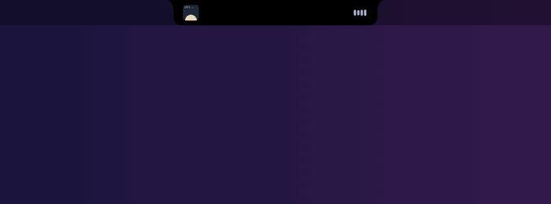
</p>

Hover the notch and it opens into a card: what's playing, the shelf, your calendar. The rest of the time it stays out of the way, and shows small, quiet notices when something happens: you plug in, your AirPods connect, a meeting is about to start, a coding agent needs you.

It's a native Swift app, event-driven from top to bottom: no polling, nothing animating once it settles, and **0.00% CPU** while it sits closed with music playing.

---

## Highlights

### 🎵 Now Playing

Apple Music and Spotify. The cover and dancing bars sit beside the closed notch, and hovering opens the full player: scrubber, transport, a scrolling title for long names, the album's colour if you like. **Playing Next** shows Apple Music's queue.

<p align="center">
  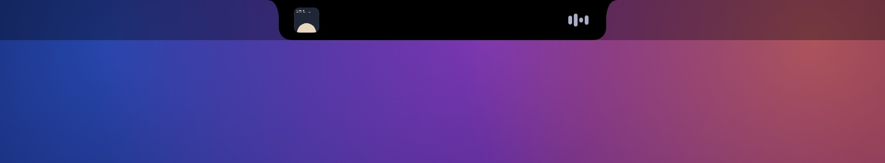<br>
  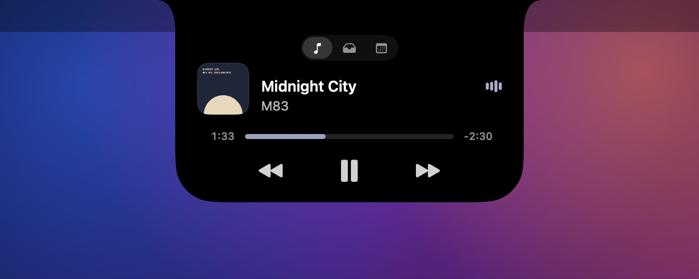
</p>

### 🎧 AirPods and headphones

Connect your AirPods and the notch drops down with the real product, the way your iPhone does, then shows each earbud's and the case's battery. Works for AirPods, AirPods Pro, AirPods Max, Beats and other Bluetooth headphones.

<table align="center">
  <tr>
    <th>AirPods Pro</th>
    <th>AirPods</th>
  </tr>
  <tr>
    <td>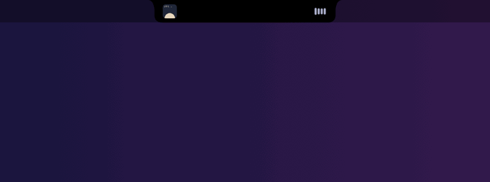</td>
    <td></td>
  </tr>
  <tr>
    <td>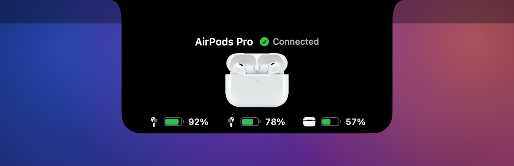</td>
    <td>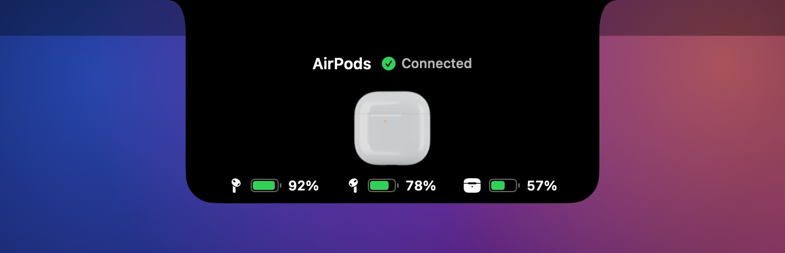</td>
  </tr>
</table>

### 🔒 Lock screen

What's playing waits above the lock screen's clock as a small Liquid Glass pill. Click it and it springs open into a player: scrub, skip and pause without unlocking. Click the cover for full-screen art with Playing Next.

<p align="center">
  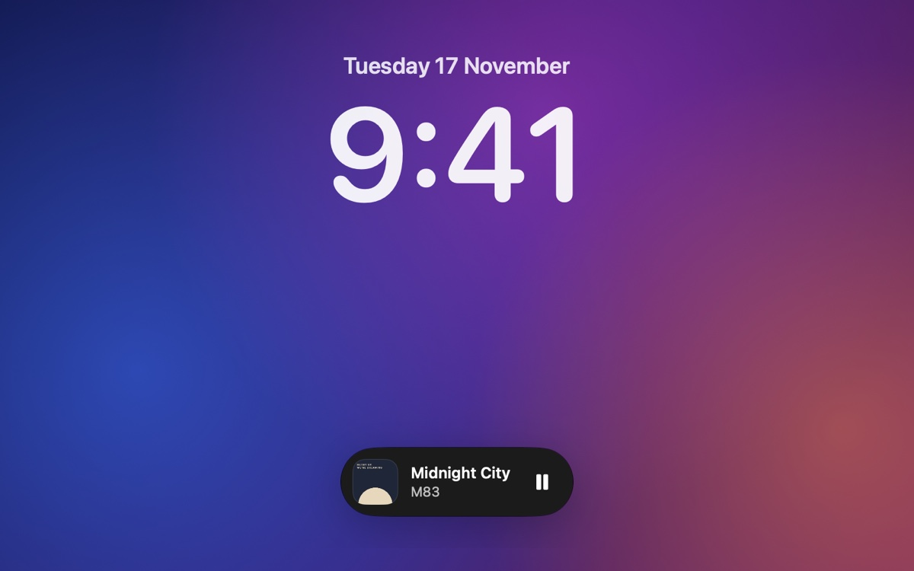
  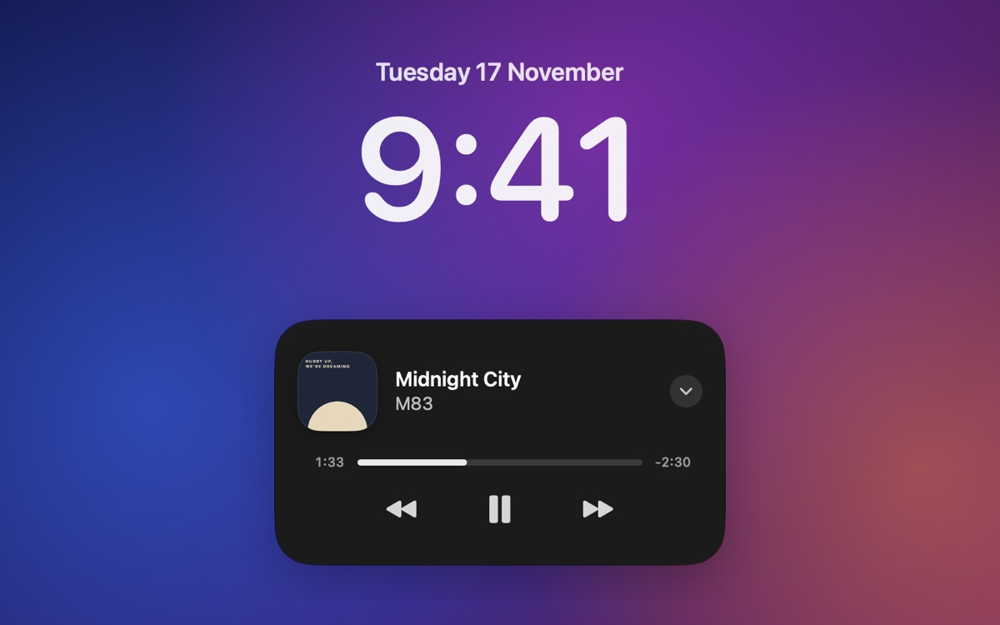
</p>

### 🗂 The Shelf

Drag files onto the notch to keep them close, then drag them out anywhere. **Transform** works on what's there: zip, convert images (PNG, JPEG, HEIC), combine into a PDF, compress, or remove a picture's background. The original is never touched.

<p align="center">
  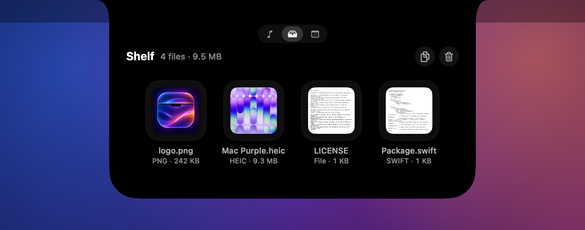
</p>

### 🤖 Coding agent status

Working with Claude Code or another coding agent? The notch shows what it's doing, tells you when it **needs you**, and when it's **done**, with what it changed. Opt in from Settings → Agent.

<p align="center">
  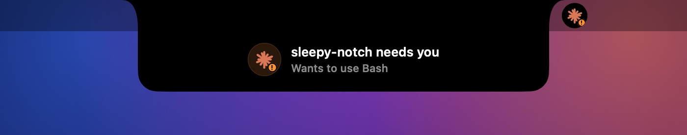<br>
  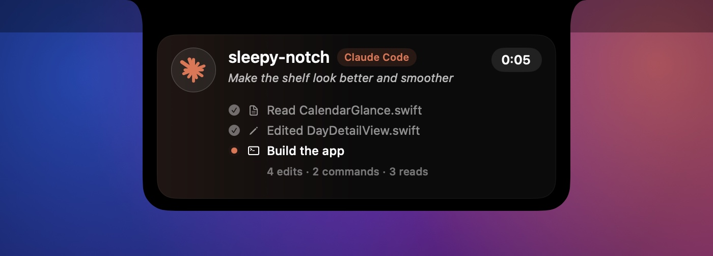
</p>

### ✨ A one-minute setup

The first launch walks you through everything (the hello, the card's pages, the player's look, what shows around the notch) and asks only for the permissions your choices need. It shows once; Settings → General → Show Setup brings it back.

<p align="center">
  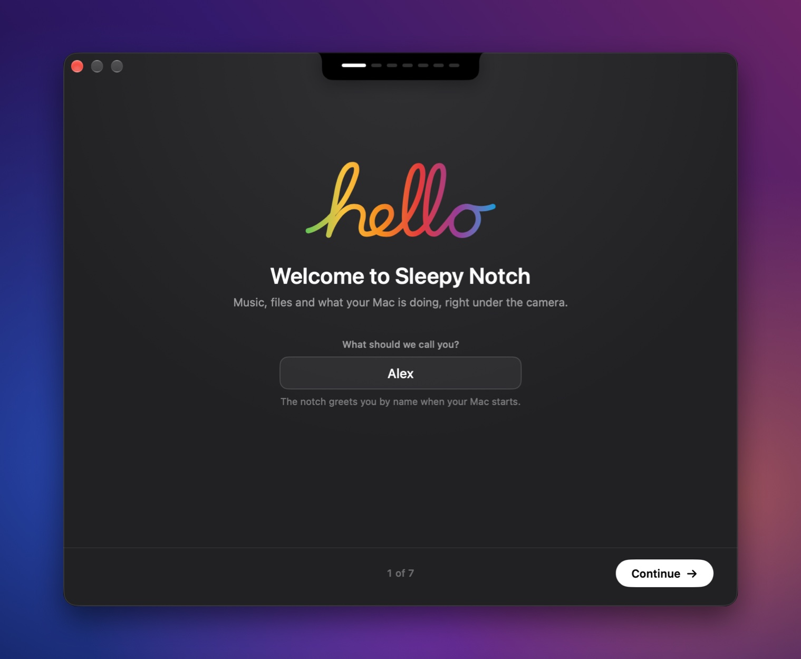
  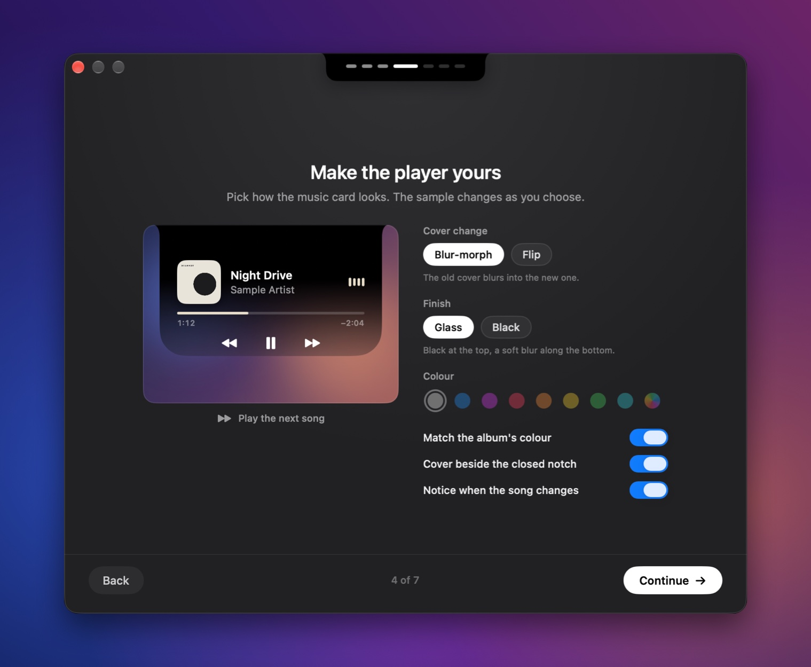<br>
  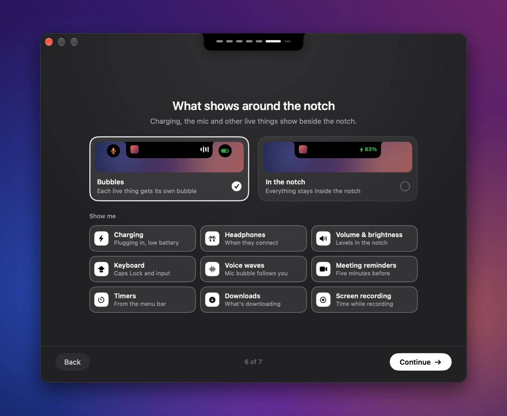
</p>

---

## Everything it does

Every feature is a switch in Settings, and costs nothing when it's off.

| | |
| :--- | :--- |
| **Card pages** | Music, Shelf, Calendar (this month and the day's events), Controls (Dark Mode, Mute, Stay Awake, Focus), Clipboard history (kept in memory only) |
| **Notices** | Charging and low battery, headphones and AirPods (with battery), Caps Lock and input language, meeting reminders, song changes, volume and brightness, downloads |
| **Live activities** | Timers and a sleep timer that fades the music out, Stay Awake, screen recording time, mic and camera in use (with voice waves), coding agents: as bubbles beside the notch or inside it |
| **Lock screen** | A Liquid Glass player above the clock; click the cover for full-screen art with Playing Next |
| **Floating player** | A small window with the song, in three sizes, from the menu bar |
| **Tools** | Capture Text (OCR anything on screen to the clipboard), Dictate to Clipboard (on-device), file transforms on the shelf |
| **Gentle reminders** | An eye break every 20 minutes and a bedtime reminder, both off by default |
| **Scripting** | `sleepynotch://` links and a local socket to show a notice or start a timer from your own scripts |
| **Looks** | Liquid Glass or solid black finish, highlight colours, a colourful or frosted hello |

## 🔋 Battery

Built to cost nothing while you're not looking at it. Measured with `scripts/measure-energy.sh`:

| State | CPU | Wake-ups / s |
| :--- | :---: | :---: |
| Closed, music playing | 0.00% | 0.0 |
| Card open | ~0.4% | ~1.5 |

How: system notifications instead of polling (Music, Spotify, IOKit, CoreAudio, EventKit), one-shot timers only, and animations handed to Core Animation so the window server runs them, not the app. Everything stops while the display sleeps, the screen is locked or the notch is hidden.

---

## Install

1. Download `SleepyNotch.dmg` from [Releases](https://github.com/anand-exe7/Sleepy-Notch/releases) and drag **Sleepy Notch** to Applications.
2. The app isn't notarized yet, so the first time macOS will say it can't be opened. Open **System Settings → Privacy & Security**, scroll down and click **Open Anyway**.
3. Follow the setup.

**Needs** macOS 13 or later, on Apple Silicon or Intel (the app is universal; Intel hasn't been tried on a real Mac yet, so tell us how it goes). It's made for MacBooks with a notch; on other screens it shows as a small pill under the menu bar.

### Permissions

Asked only when a feature you turned on needs them, and everything stays on your Mac.

| Permission | For |
| :--- | :--- |
| Automation (Music, Spotify) | Reading the song and play, pause, skip |
| Calendar | The Calendar page and meeting reminders |
| Microphone | Voice waves in the mic bubble (nothing is recorded) |
| Accessibility | Caps Lock notices, hiding macOS's own volume pop-ups (optional) |
| Downloads folder | Showing what's downloading |
| Screen Recording | Capture Text |
| Speech Recognition | Dictation and transcribing audio |

---

## Build from source

Needs the Swift toolchain (Xcode or the Command Line Tools, Swift 5.9+).

```bash
git clone https://github.com/anand-exe7/Sleepy-Notch.git
cd Sleepy-Notch
swift run
```

Build the app bundle and the DMG:

```bash
scripts/make-app.sh --dmg
```

The app lands in `build/Sleepy Notch.app` and the disk image in `build/SleepyNotch.dmg`. Run the packaged app when testing permissions: a bare `swift run` doesn't get macOS's permission prompts.

Handy while working on it:

- `scripts/measure-energy.sh [seconds]`: CPU, wake-ups and energy of the running app
- `scripts/onboarding-demo.sh [--auto]`: replay the setup without marking it done
- Menu bar → 🧪 Feature Lab: simulate any notice or activity (development builds; in a release, `defaults write com.anandexe7.sleepy-notch debug.featureLab -bool YES` and relaunch)

<details>
<summary><b>Project layout</b></summary>

```
Sources/SleepyNotch/
├── App/            Entry point, wiring (AppEnvironment, AppWiring), menu bar
├── Core/           Models and small helpers, no UI
├── Services/       Music sources, system monitors, the notch window
├── DesignSystem/   Shared visuals: the notch shape, glass, bars, marquee
└── Features/       Notch, Player, Peeks, Activities, Shelf, Settings,
                    Lock Screen, Onboarding, Widgets, …
```

`Core/` and `Services/` never import `Features/` or `DesignSystem/`; `App/` is the only place concrete types are wired together.

</details>

---

## Contributing

Bug reports, ideas and pull requests are welcome. Start with [CONTRIBUTING.md](CONTRIBUTING.md): how to set up, how the code is laid out, and the few rules that keep the app light on battery. Found a bug? [Open an issue](https://github.com/anand-exe7/Sleepy-Notch/issues/new/choose).

## Credits

Made by **Anand Sivaram S**, with **Vinoth Anand Gani** (live activities, side bubbles, voice waves).

## License

[MIT](LICENSE)
